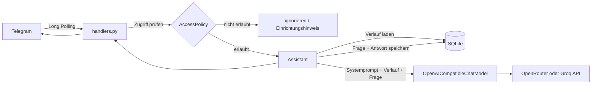
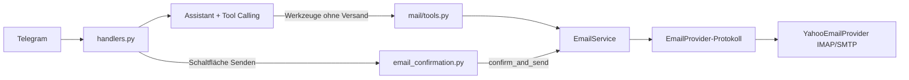
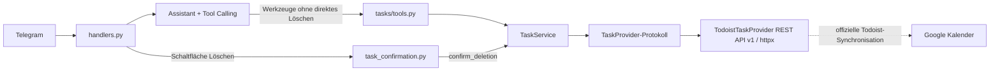
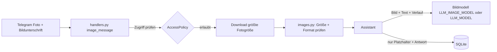
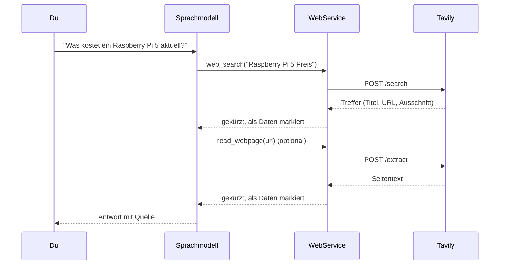

# Persönlicher Telegram-KI-Assistent (OpenRouter + Docker)

Ein privater KI-Assistent für Telegram. Der Bot beantwortet Textnachrichten über ein
Sprachmodell (standardmäßig über die OpenRouter API, alternativ Groq), merkt sich den
Gesprächsverlauf in SQLite (auch nach Neustarts) und läuft
dauerhaft als Docker-Container auf einem Linux-Homeserver (z. B. umbrelOS).

Funktionen (MVP):

- Text-Chat per Long Polling (kein Webhook, keine offenen Ports nötig)
- Persistenter, begrenzter Gesprächsverlauf pro Chat
- Befehle `/start`, `/help`, `/reset`, `/whoami`
- Nur private Chats, nur ein freigegebener Telegram-Nutzer
- Statusmeldungen: Beim Start schickt der Assistent dem freigegebenen Nutzer eine Begrüßung, beim geordneten Beenden (`docker stop`, Neustart) eine kurze Abwesenheitsmeldung. Beide Texte formuliert das Sprachmodell jedes Mal neu (in der Persönlichkeit aus `PERSONALITY_FILE`, bei Firzana mit "Assalam Alaykum" und "Khuda Hafiz"/"Allah Hafiz"; Anweisungen in `prompts.py`), aber höchstens `STATUS_LLM_MAX_PER_MINUTE` (Standard 2) Mal pro Minute, auch über Neustarts hinweg. Darüber hinaus, bei Fehlern oder wenn das Modell nicht rechtzeitig antwortet (10 s beim Start, 5 s beim Beenden), wird ein fester Text gesendet. Mit `STATUS_MESSAGES_ENABLED=false` entfallen beide Meldungen. Bei einem Absturz oder `kill -9` entfällt die Abwesenheitsmeldung.
- Menschliche Fehlermeldungen: Technische Probleme (Anfragelimit, zu großes Bild, Zeitüberschreitung, leeres Guthaben, unbekannter Befehl usw.) werden nicht mit festen Texten gemeldet. Das Sprachmodell erklärt sie in der Persönlichkeit aus `PERSONALITY_FILE`, ohne Fehlercodes (Anweisung `ERROR_INSTRUCTION` in `prompts.py`). Nur wenn das Modell dabei selbst nicht rechtzeitig (10 s) antwortet, gilt ein fester Ersatztext. Die Details stehen weiterhin im Log.
- Austauschbare Persönlichkeit: Name, Biografie, Sprache, Begrüßung und Abschied stehen in einer Textdatei (`personality.md` neutral als Standard, `personalities/firzana.md` mitgeliefert), die allgemeinen Regeln im Code (siehe [Persönlichkeit](#persönlichkeit-personalitymd))
- Optional: E-Mail-Integration (Yahoo Mail) – lesen, suchen, Entwürfe und Antworten;
  Versand nur nach Bestätigung per Schaltfläche (siehe [E-Mail-Integration](#e-mail-integration-yahoo))
- Optional: Aufgaben-Integration (Todoist) – Aufgaben per Nachricht anlegen, anzeigen, ändern,
  erledigen; Löschen nur nach Bestätigung (siehe [Aufgaben-Integration](#aufgaben-integration-todoist))
- Optional: Bilder verarbeiten (Modell mit Bildverständnis) – Text aus Fotos lesen,
  Bilder beschreiben, Fragen zum Bild beantworten (siehe [Bildverarbeitung](#bildverarbeitung-vision-modell))
- Optional: Websuche (Tavily) – im Internet recherchieren und Webseiten lesen, mit Tageslimit
  (siehe [Websuche](#websuche-tavily))

## Inhalt

1. [Architektur](#architektur)
2. [Lokale Einrichtung unter Windows](#lokale-einrichtung-unter-windows)
3. [Tests](#tests)
4. [Docker lokal](#docker-lokal)
5. [Deployment auf umbrelOS](#deployment-auf-umbrelos)
6. [Portainer](#portainer)
7. [Konfiguration](#konfiguration)
8. [Docker-Konfiguration erklärt](#docker-konfiguration-erklärt)
9. [Sicherheit](#sicherheit)
10. [Erweitern](#erweitern)
11. [Fehlerbehebung](#fehlerbehebung)
12. [E-Mail-Integration (Yahoo)](#e-mail-integration-yahoo)
13. [Aufgaben-Integration (Todoist)](#aufgaben-integration-todoist)
14. [Bildverarbeitung (Vision-Modell)](#bildverarbeitung-vision-modell)
15. [Websuche (Tavily)](#websuche-tavily)

## Architektur

```text
.
├── assistant_bot/
│   ├── __main__.py           Einstiegspunkt: Konfiguration, Logging, Verdrahtung, Polling
│   ├── config.py             Umgebungsvariablen laden und validieren (Settings)
│   ├── logging_config.py     Logging nach stdout, Geheimnisse werden geschwärzt
│   ├── prompts.py            Allgemeine Prompt-Regeln und Anweisungen (Persönlichkeit steht in personality.md)
│   ├── messages.py           ChatMessage (gemeinsames Nachrichtenmodell)
│   ├── llm/                  Sprachmodell-Anbindung (OpenRouter oder Groq)
│   │   ├── base.py           ChatModel-Protokoll, Fehlerklassen, Antwortbereinigung
│   │   ├── openai_compatible.py  Adapter für OpenAI-kompatible APIs + Fehlerübersetzung
│   │   └── factory.py        Anbieter-Voreinstellungen und Aufbau aus den Einstellungen
│   ├── conversation.py       Conversation-Service: Verlauf in SQLite
│   ├── assistant.py          Anwendungslogik: Prompt + Verlauf + Modell (+ Tool-Calling-Schleife)
│   ├── tools.py              Minimale Werkzeug-Registry für Tool Calling
│   ├── images.py             Prüfung eingehender Bilder (Format per Signatur, Größe)
│   ├── mail/                 E-Mail-Integration (optional)
│   │   ├── models.py         Provider-unabhängige Datenmodelle, Fehler, Adressprüfung
│   │   ├── provider.py       EmailProvider-Protokoll (Schnittstelle für Yahoo, Gmail, ...)
│   │   ├── yahoo.py          YahooEmailProvider (IMAP/SMTP)
│   │   ├── mime.py           MIME parsen/erzeugen, HTML -> Text
│   │   ├── service.py        EmailService: Nummerierung, Entwürfe, Versandfreigabe
│   │   ├── tools.py          E-Mail-Werkzeuge für das Sprachmodell (ohne Versand-Werkzeug)
│   │   └── factory.py        Provider-Auswahl über EMAIL_PROVIDER
│   ├── tasks/                Aufgaben-Integration (optional)
│   │   ├── models.py         Provider-unabhängige Datenmodelle und Fehler
│   │   ├── provider.py       TaskProvider-Protokoll (Schnittstelle für Todoist, ...)
│   │   ├── todoist.py        TodoistTaskProvider (REST API v1 über httpx)
│   │   ├── service.py        TaskService: Datum/Zeitzone, Zuordnung, Duplikatschutz, Löschfreigabe
│   │   ├── tools.py          Aufgaben-Werkzeuge für das Sprachmodell (ohne direktes Löschen)
│   │   ├── check.py          Verbindungstest: python -m assistant_bot.tasks.check
│   │   └── factory.py        Provider-Auswahl über TASK_PROVIDER
│   ├── web/                  Websuche (optional)
│   │   ├── models.py         Suchtreffer, Seiten, Fehlerklassen
│   │   ├── provider.py       WebProvider-Protokoll (Schnittstelle für Tavily, ...)
│   │   ├── tavily.py         TavilyWebProvider (Search- und Extract-API über httpx)
│   │   ├── service.py        WebService: Eingabe-/URL-Prüfung, Kürzen, Tageslimit
│   │   ├── tools.py          Werkzeuge web_search und read_webpage, Inhalte als Daten markiert
│   │   └── factory.py        Provider-Auswahl über WEB_SEARCH_PROVIDER
│   └── telegram_bot/
│       ├── application.py    Aufbau der python-telegram-bot Application
│       ├── handlers.py       Befehle, Textnachrichten, Fehlerbehandlung
│       ├── email_confirmation.py  Entwurfsanzeige und Senden/Verwerfen-Schaltflächen
│       ├── task_confirmation.py   Löschbestätigung mit Löschen/Behalten-Schaltflächen
│       ├── access.py         Zugriffskontrolle (AccessPolicy)
│       └── message_split.py  Lange Antworten aufteilen
├── tests/                    pytest, ohne echte Zugangsdaten
├── personality.md            Neutrale Standard-Persönlichkeit
├── personalities/            Fertige Persönlichkeiten (firzana.md), Auswahl über PERSONALITY_FILE
├── Dockerfile
├── compose.yaml
├── .env.example
├── requirements.txt          Laufzeit-Abhängigkeiten (gepinnt)
└── requirements-dev.txt      zusätzlich pytest
```

Ablauf einer Nachricht:



Wichtige Entscheidungen:

- **Schichten statt Framework:** Telegram (`telegram_bot/`), Anwendungslogik (`assistant.py`),
  Speicherung (`conversation.py`) und Modell (`llm/`) sind getrennt. Der `Assistant` kennt
  weder Telegram noch einen Anbieter, sondern nur das kleine `ChatModel`-Protokoll. Ein anderer
  Modellanbieter oder ein weiterer Kanal lässt sich so austauschen bzw. ergänzen.
- **Ein Adapter für mehrere Anbieter:** OpenRouter und Groq sprechen beide das
  OpenAI-Protokoll. `OpenAICompatibleChatModel` nutzt dafür das `openai`-SDK; der Anbieter
  unterscheidet sich nur in `base_url` und dem Namen des Token-Limit-Parameters
  (`LLM_PROVIDER`, siehe `llm/factory.py`).
- **Fehlerübersetzung im LLM-Service:** SDK-Fehler werden in eigene Klassen
  (`LLMRateLimitError`, `LLMInsufficientCreditsError`, `LLMTimeoutError`, ...) übersetzt.
  Die Handler lassen das Sprachmodell dazu eine verständliche, menschliche Antwort schreiben (mit festem Ersatztext). Auch Fehler, die OpenRouter
  trotz HTTP 200 im Antworttext meldet, werden erkannt. Das SDK selbst wiederholt
  Netzwerkfehler, 429 und 5xx automatisch (`LLM_MAX_RETRIES`).
- **Verlauf wird erst nach erfolgreicher Antwort gespeichert:** Schlägt eine Anfrage fehl,
  bleibt der Kontext sauber (keine Fragen ohne Antwort).
- **Begrenzter Kontext:** Nur die letzten `HISTORY_MAX_MESSAGES` Nachrichten werden
  mitgesendet. Ältere Nachrichten bleiben in der Datenbank, werden aber nicht mehr verwendet.
- **SQLite ohne ORM:** Standardbibliothek, eine Tabelle, jede Operation mit eigener
  kurzlebiger Verbindung in einem Worker-Thread (`asyncio.to_thread`), damit der Bot nicht blockiert.
- **Zugriffsprüfung vor jeder KI-Anfrage:** Fremde Nutzer erhalten keine Antwort und
  verursachen keine Kosten beim Modellanbieter.
- **Reiner Text:** Antworten werden ohne Markdown-Parsing gesendet. Der Systemprompt bittet
  das Modell deshalb, auf Markdown zu verzichten. So kann eine Antwort nie an
  Formatierungsfehlern scheitern.

## Lokale Einrichtung unter Windows

Voraussetzungen: Python 3.12 (3.11 funktioniert ebenfalls), VS Code, Git.

### 1. Telegram-Bot anlegen

1. In Telegram mit [@BotFather](https://t.me/BotFather) chatten und `/newbot` senden.
2. Namen und Benutzernamen vergeben. BotFather liefert den **Bot-Token**.

### 2. API-Key erstellen

Standard ist OpenRouter: Unter [openrouter.ai/keys](https://openrouter.ai/keys) einen API-Key
anlegen und Guthaben aufladen. Den Modellnamen (z. B. `openai/gpt-oss-120b`) gibt es unter
[openrouter.ai/models](https://openrouter.ai/models). Das Textmodell muss Werkzeugaufrufe
(Tool Calling) unterstützen. Für Bilder muss das verwendete Modell Bilder verstehen können.

Alternativ Groq: `LLM_PROVIDER=groq` setzen und unter
[console.groq.com/keys](https://console.groq.com/keys) einen Key anlegen.

### 3. Projekt einrichten (PowerShell im Projektordner)

```powershell
python -m venv .venv
.\.venv\Scripts\Activate.ps1
python -m pip install -r requirements-dev.txt
Copy-Item .env.example .env
```

Falls `Activate.ps1` wegen der Ausführungsrichtlinie blockiert wird, einmalig
`Set-ExecutionPolicy -Scope CurrentUser RemoteSigned` ausführen oder die Befehle direkt
mit `.\.venv\Scripts\python.exe` aufrufen.

In VS Code: `Strg+Shift+P` → "Python: Select Interpreter" → `.venv` auswählen.

### 4. `.env` ausfüllen

`.env` in VS Code öffnen und `TELEGRAM_BOT_TOKEN`, `LLM_MODEL` sowie `OPENROUTER_API_KEY`
(bzw. `GROQ_API_KEY` bei `LLM_PROVIDER=groq`) eintragen.
`ALLOWED_TELEGRAM_USER_ID` zunächst leer lassen. Die Datei ist in `.gitignore` eingetragen
und wird nie committet.

### 5. Starten und eigene User-ID ermitteln

```powershell
python -m assistant_bot
```

1. Der Bot läuft im **Einrichtungsmodus** (Warnung im Log). Es werden keine KI-Anfragen gestellt.
2. Dem Bot in Telegram `/whoami` schicken. Er antwortet mit deiner numerischen User-ID.
3. Bot mit `Strg+C` stoppen, die ID als `ALLOWED_TELEGRAM_USER_ID` in `.env` eintragen.
4. Erneut starten. Ab jetzt antwortet der Bot ausschließlich dir.

Die Datenbank liegt lokal unter `data/assistant.db`.

## Tests

```powershell
python -m pytest
```

Die Tests verwenden ausschließlich Dummy-Werte und einen gemockten LLM-Client. Es werden
keine Netzwerk- oder kostenpflichtigen API-Anfragen ausgeführt. Abgedeckt sind:

- Konfigurationsvalidierung (`tests/test_config.py`)
- Gesprächsverwaltung, Kontextbegrenzung, Persistenz und `/reset` (`tests/test_conversation.py`)
- Zugriffskontrolle und Handler-Verhalten (`tests/test_access.py`)
- LLM-Service inkl. Fehlerfälle und Anbieterauswahl (`tests/test_llm.py`)
- Aufteilen langer Nachrichten und Schwärzen von Geheimnissen im Log
- E-Mail-Integration mit gefälschten IMAP/SMTP-Verbindungen (`tests/test_email_*.py`, `tests/test_mail_mime.py`, `tests/test_yahoo_provider.py`)
- Aufgaben-Integration mit gemockter Todoist-API (`tests/test_task_*.py`, `tests/test_todoist_provider.py`)
- Bildverarbeitung: Konfiguration, Bildprüfung, Modellwahl, Telegram-Handler (`tests/test_images.py`)
- Persönlichkeitsdatei: Laden, Fehlerfälle, Systemprompt (`tests/test_personality.py`)

In VS Code können die Tests auch über die Test-Ansicht (Kolben-Symbol) mit pytest ausgeführt werden.

## Docker lokal

Mit Docker Desktop (optional):

```powershell
docker compose up -d --build
docker compose logs -f
docker compose down
```

`compose.yaml` liest die Werte aus der `.env` im Projektordner.

Nach der Umstellung von Groq auf OpenRouter muss die `.env` auf die neuen Variablennamen
(`LLM_*`, `OPENROUTER_API_KEY`) umgestellt werden; die alten `GROQ_MODEL`, `GROQ_IMAGE_MODEL`
usw. werden nicht mehr gelesen. Das Image muss neu gebaut werden (`--build`), weil sich die
Abhängigkeiten geändert haben.

## Deployment auf umbrelOS

Der Bot wird **nicht** als Umbrel-App, sondern als eigenständiges Compose-Projekt neben den
Umbrel-Apps betrieben. Er benötigt keine Ports.

### 1. Per SSH verbinden

```powershell
ssh umbrel@umbrel.local
```

(Passwort = Umbrel-Passwort. Alternativ die IP-Adresse des Servers verwenden.)

### 2. Projekt auf den Server bringen

Das Projekt in einem eigenen Ordner ablegen, z. B. `~/telegram-assistant` –
**nicht** innerhalb von `~/umbrel`, da dieser Ordner von umbrelOS verwaltet wird.

Variante A – per Git (falls das Repository online liegt und `git` verfügbar ist):

```bash
git clone <REPO-URL> ~/telegram-assistant
```

Variante B – Kopie von Windows aus (PowerShell im Projektordner):

```powershell
tar -czf telegram-assistant.tar.gz --exclude=.venv --exclude=.git --exclude=data --exclude=.env --exclude=__pycache__ --exclude=.pytest_cache .
scp telegram-assistant.tar.gz umbrel@umbrel.local:~/
```

Auf dem Server:

```bash
mkdir -p ~/telegram-assistant
tar -xzf ~/telegram-assistant.tar.gz -C ~/telegram-assistant
rm ~/telegram-assistant.tar.gz
```

### 3. `.env` auf dem Server anlegen

```bash
cd ~/telegram-assistant
cp .env.example .env
nano .env          # Token, API-Key und User-ID eintragen, speichern mit Strg+O, Strg+X
chmod 600 .env
```

`DATABASE_PATH` wird im Container ignoriert; dort gilt immer `/data/assistant.db`.

### 4. Starten

```bash
docker compose up -d --build
docker compose logs -f
```

Falls Docker Rechte fehlen, die Befehle mit `sudo` ausführen. Das Image wird direkt auf dem
Server gebaut, dadurch passt die Architektur automatisch (amd64 oder arm64).

Durch `restart: unless-stopped` startet der Bot nach einem Server-Neustart automatisch.

### Updates

```bash
cd ~/telegram-assistant
git pull                       # bzw. neue Dateien per scp kopieren (.env bleibt erhalten)
docker compose up -d --build
docker image prune -f          # optional: alte Images entfernen
```

### Backup der Datenbank

```bash
docker compose cp bot:/data/assistant.db ./assistant-backup.db
```

Die Daten liegen im benannten Volume `telegram-assistant_assistant-data` und bleiben bei
`docker compose down` und Updates erhalten. Nur `docker compose down -v` löscht sie.

## Portainer

Hinweis: Die Portainer-App aus dem Umbrel App Store läuft in der Regel in einer eigenen,
isolierten Docker-Umgebung. Container, die per SSH mit `docker compose` gestartet wurden,
sind dort daher möglicherweise **nicht** sichtbar. Zwei Möglichkeiten:

- **Per SSH betreiben** (oben beschrieben) und Logs mit `docker compose logs -f` ansehen.
- **Als Portainer-Stack betreiben:** In Portainer *Stacks → Add stack → Repository* das
  Git-Repository angeben (Compose-Pfad `compose.yaml`). Unter *Environment variables* die
  Werte aus `.env.example` eintragen (mindestens `TELEGRAM_BOT_TOKEN`, `LLM_MODEL`, `OPENROUTER_API_KEY`,
  `ALLOWED_TELEGRAM_USER_ID`). Portainer baut das Image dann selbst. Logs sind im
  Container-Detail unter *Logs* sichtbar.

Den Bot nicht gleichzeitig per SSH und als Portainer-Stack betreiben: Telegram erlaubt pro
Token nur einen Polling-Prozess (sonst Fehler `Conflict`).

## Konfiguration

Alle Einstellungen erfolgen über Umgebungsvariablen (`.env`). Ungültige Werte führen beim
Start zu einer gesammelten Fehlermeldung, Geheimnisse werden dabei nicht ausgegeben.

| Variable | Pflicht | Standard | Beschreibung |
|---|---|---|---|
| `TELEGRAM_BOT_TOKEN` | ja | – | Token von @BotFather |
| `LLM_PROVIDER` | nein | `openrouter` | `openrouter` oder `groq` |
| `OPENROUTER_API_KEY` | bei `openrouter` | – | OpenRouter API-Key (openrouter.ai/keys) |
| `GROQ_API_KEY` | bei `groq` | – | Groq API-Key. Nur der Key des gewählten Anbieters ist Pflicht |
| `ALLOWED_TELEGRAM_USER_ID` | nein | leer | Einzige erlaubte User-ID. Leer = Einrichtungsmodus |
| `OWNER_NAME` | nein | `Ali` | Name des Besitzers im Systemprompt |
| `PERSONALITY_FILE` | nein | `personality.md` | Textdatei mit der Persönlichkeit (UTF-8, höchstens 20000 Zeichen). Fehlt sie oder ist sie leer, bricht der Start mit einer Meldung ab |
| `LLM_MODEL` | ja | – | Modell-ID für Textnachrichten, z. B. `openai/gpt-oss-120b`. Muss Werkzeugaufrufe können |
| `LLM_IMAGE_MODEL` | nein | leer | Modell für Fotos. Leer = das Textmodell verarbeitet auch Bilder (muss dann Bilder verstehen) |
| `LLM_TEMPERATURE` | nein | `0.7` | 0 bis 2 |
| `LLM_MAX_TOKENS` | nein | `2048` | Maximale Antwortlänge in Tokens (64 bis 32768). Bei Modellen mit Denkphase groß genug wählen |
| `LLM_TIMEOUT_SECONDS` | nein | `60` | Timeout pro Anfrage (1 bis 600) |
| `LLM_MAX_RETRIES` | nein | `2` | Automatische Wiederholungen (0 bis 10) |
| `LLM_REASONING` | nein | `false` | `false` schaltet die Denkphase des Modells aus (nur OpenRouter). `true` lässt das Modell intern denken (langsamer), die Gedanken werden nie in die Antwort übernommen. Modelle, die nur mit Denkphase laufen, brauchen `true` |
| `IMAGE_MAX_MB` | nein | `5` | Größte erlaubte Bilddatei in MB (1 bis 20). Bei Groq höchstens ca. 3 |
| `HISTORY_MAX_MESSAGES` | nein | `20` | Kontextgröße in Nachrichten (1 bis 200) |
| `IMAGE_HISTORY_MAX_MESSAGES` | nein | `4` | Verlauf in Nachrichten bei Bildanfragen (0 bis 200, `0` = keiner; nie mehr als `HISTORY_MAX_MESSAGES`) |
| `STATUS_MESSAGES_ENABLED` | nein | `true` | `false` schaltet Begrüßung beim Start und Abschiedsnachricht beim Beenden komplett ab |
| `STATUS_LLM_MAX_PER_MINUTE` | nein | `2` | Wie oft pro Minute Start-/Stoppmeldungen vom Sprachmodell formuliert werden dürfen (0 bis 60, `0` = immer fester Text). Darüber hinaus (z. B. Neustart-Schleife) wird ein fester Text ohne LLM-Anfrage gesendet; der Zähler liegt in der Datenbank und überlebt Neustarts |
| `MAX_INPUT_CHARS` | nein | `4000` | Maximale Länge einer Nutzernachricht (1 bis 4096) |
| `DATABASE_PATH` | nein | `data/assistant.db` | Nur lokal relevant; im Container `/data/assistant.db` |
| `LOG_LEVEL` | nein | `INFO` | `DEBUG`, `INFO`, `WARNING`, `ERROR`, `CRITICAL` |
| `EMAIL_PROVIDER` | nein | leer | `yahoo` aktiviert die E-Mail-Funktionen. Leer = deaktiviert |
| `EMAIL_ADDRESS` | bei E-Mail | – | Vollständige Yahoo-Adresse |
| `EMAIL_APP_PASSWORD` | bei E-Mail | – | Yahoo-App-Passwort (nicht das Konto-Passwort) |
| `EMAIL_SENDER_NAME` | nein | `OWNER_NAME` | Absendername im From-Header |
| `EMAIL_ALLOWED_RECIPIENTS` | nein | leer | Kommagetrennte Freigabeliste: Adressen oder `@domain`. Leer = keine Einschränkung (Versand trotzdem nur per Schaltfläche) |
| `EMAIL_DRAFT_TTL_SECONDS` | nein | `900` | Gültigkeit einer Versandfreigabe (60 bis 86400) |
| `EMAIL_TIMEOUT_SECONDS` | nein | `30` | Zeitlimit für IMAP/SMTP (5 bis 300) |
| `EMAIL_MAX_BODY_CHARS` | nein | `6000` | Max. Zeichen eines Mailtexts, die an das Sprachmodell gehen (500 bis 50000) |
| `TASK_PROVIDER` | nein | leer | `todoist` aktiviert die Aufgaben-Funktionen. Leer = deaktiviert |
| `TODOIST_API_TOKEN` | bei Aufgaben | – | API-Token aus Todoist (Einstellungen -> Integrationen -> Entwickler) |
| `TODOIST_TIMEOUT_SECONDS` | nein | `15` | Zeitlimit für Todoist-Anfragen (3 bis 120) |
| `WEB_SEARCH_PROVIDER` | nein | leer | `tavily` aktiviert die Websuche. Leer = deaktiviert |
| `TAVILY_API_KEY` | bei Websuche | – | API-Key von app.tavily.com |
| `WEB_TIMEOUT_SECONDS` | nein | `20` | Zeitlimit für Such- und Leseanfragen (3 bis 120) |
| `WEB_MAX_RESULTS` | nein | `5` | Treffer pro Suche (1 bis 20) |
| `WEB_MAX_CHARS` | nein | `4000` | Max. Zeichen pro Treffer bzw. gelesener Seite, die an das Sprachmodell gehen (500 bis 50000) |
| `WEB_MAX_CALLS_PER_DAY` | nein | `30` | Max. Such-/Leseanfragen pro Tag (0 bis 10000, `0` = unbegrenzt). Zähler im Arbeitsspeicher, ein Neustart setzt ihn zurück |
| `TIMEZONE` | nein | `Europe/Berlin` | Zeitzone für Datum/Uhrzeit (IANA-Name, z. B. `Europe/Vienna`) |

Die Persönlichkeit anpassen: siehe [Persönlichkeit](#persönlichkeit-personalitymd).

## Persönlichkeit (`personality.md`)

Der Systemprompt besteht aus zwei Teilen:

1. **Persönlichkeit** aus einer Textdatei: Standard ist die neutrale `personality.md` im Projektordner. Fertige
   Persönlichkeiten liegen in `personalities/` (mitgeliefert: `firzana.md`, `hamid.md`) und werden mit `PERSONALITY_FILE`
   ausgewählt, z. B. `PERSONALITY_FILE=personalities/firzana.md`. Die Datei enthält Name,
   Biografie, Charakter, Sprache und Anrede, Begrüßung, Abschied, Schreibstil und Tonfall bei Fehlern.
2. **Allgemeine Regeln** in `assistant_bot/prompts.py`: Aufgaben, Ehrlichkeit, Freigaben, Datenschutz sowie die
   Hinweise zu E-Mail, Aufgaben und Bildern. Sie gelten für jede Persönlichkeit.

Im Text der Datei wird `{owner_name}` durch `OWNER_NAME` ersetzt. Alles andere (auch andere geschweifte
Klammern) bleibt unverändert. Die Datei wird beim Start gelesen; nach einer Änderung den Bot bzw. Container neu starten.

Begrüßung, Abschied und Fehlermeldungen schreibt das Sprachmodell nach den Regeln dieser Datei. Der Code selbst
enthält keine persönlichkeitsspezifischen Formeln (die festen Ersatztexte bei Modellausfall sind neutral).
Soll z. B. jede Begrüßung mit einer bestimmten Formel beginnen, steht das im Abschnitt "Begrüßung und Abschied"
der Datei.

### Zweiter Bot mit anderer Persönlichkeit

Ein zweiter Container braucht einen eigenen Bot-Token (@BotFather), ein eigenes Volume (Datenbank) und einen
eigenen Compose-Projekt- und Containernamen. `Dockerfile` und Code bleiben gleich. Die Persönlichkeit
wählt `PERSONALITY_FILE`; der Ordner `personalities/` ist in den Container eingebunden.

1. Persönlichkeit anlegen, z. B. `personalities/layla.md` (am einfachsten als Kopie von `personalities/firzana.md`
   oder `personality.md`, dann anpassen).
2. `compose.yaml` kopieren (z. B. nach `compose.layla.yaml`) und `name:` sowie `container_name:` ändern,
   z. B. auf `telegram-assistant-layla`. Der Projektname bestimmt auch den Volume-Namen; bei gleichem Namen
   würden sich beide Bots die Datenbank teilen.
3. Eigene Env-Datei `.env.layla` mit neuem `TELEGRAM_BOT_TOKEN` und `PERSONALITY_FILE=personalities/layla.md`.
   `OPENROUTER_API_KEY` und `LLM_MODEL` dürfen gleich bleiben. Die Datei enthält Geheimnisse und darf nicht
   ins Repository.
4. Starten:

```powershell
docker compose -f compose.layla.yaml --env-file .env.layla up -d --build
```

Lokal ohne Docker genügt `PERSONALITY_FILE=personalities/layla.md` in einer eigenen `.env`.

## Docker-Konfiguration erklärt

- **`python:3.12-slim`:** offizielles, kleines Basis-Image, verfügbar für amd64 und arm64.
- **Layer-Reihenfolge:** Erst `requirements.txt` installieren, dann den Code kopieren.
  Codeänderungen bauen dadurch schnell neu.
- **Nicht-Root-Benutzer** (`assistant`, UID 10001): Der Prozess hat im Container keine Root-Rechte.
- **Exec-Form von `CMD`:** Python ist PID 1 und erhält `SIGTERM` von `docker stop` direkt.
  python-telegram-bot beendet dann das Polling sauber und schließt die Verbindung zum Modellanbieter.
  `stop_grace_period: 20s` gibt laufenden Anfragen Zeit zum Abschluss.
- **Benanntes Volume `/data`:** hält die SQLite-Datenbank über Neustarts und Updates hinweg.
  Ein benanntes Volume übernimmt die Rechte des Image-Ordners, daher sind keine manuellen
  `chown`-Schritte nötig. (Bei einem Bind-Mount müsste der Host-Ordner UID 10001 gehören.)
- **Härtung:** `read_only: true` (schreibbar sind nur `/data` und ein `tmpfs` für `/tmp`),
  `cap_drop: ALL`, `no-new-privileges`, `mem_limit: 256m`.
- **Keine Ports:** Long Polling baut nur ausgehende Verbindungen auf.
- **Log-Rotation:** `json-file` mit max. 3 × 10 MB, damit Logs die Festplatte nicht füllen.
- **Kein Healthcheck:** Bei einem fatalen Fehler beendet sich der Prozess, und
  `restart: unless-stopped` startet ihn neu. Netzwerkunterbrechungen überbrückt
  python-telegram-bot selbst.
- **`.dockerignore`:** `.env`, `.git`, Tests und lokale Daten gelangen nicht ins Image.

## Sicherheit

- Geheimnisse ausschließlich über Umgebungsvariablen; `.env` ist in `.gitignore` und `.dockerignore`.
- Token und API-Key werden in allen Logausgaben (inkl. Tracebacks) durch `***` ersetzt.
  Die `httpx`-Request-Logs (die den Bot-Token in der URL enthalten) sind abgeschaltet.
- Nachrichteninhalte werden nicht geloggt, nur Metadaten (Chat-ID, Längen, Fehlertypen).
- Zugriff nur für `ALLOWED_TELEGRAM_USER_ID` und nur in privaten Chats; Fremde erhalten
  keine Antwort, Versuche werden mit User-ID geloggt.
- Eingaben sind in der Länge begrenzt; der Bot führt keine Shell-Befehle oder Code aus. Das
  Sprachmodell kann nur die fest registrierten E-Mail-Werkzeuge aufrufen (kein Versand-Werkzeug).
- Die Datenbank enthält Gesprächsinhalte im Klartext. Backups entsprechend schützen.
- Falls ein Token bekannt wird: bei @BotFather `/revoke` bzw. in der OpenRouter- oder Groq-Konsole den Key
  widerrufen und neu eintragen.

## Erweitern

- **Persönlichkeit:** `personality.md` bzw. `personalities/*.md` (Auswahl über `PERSONALITY_FILE`); allgemeine Regeln in `assistant_bot/prompts.py`.
- **Neue Befehle:** Methode in `BotHandlers` ergänzen, in `application.py` registrieren und
  in `BOT_COMMANDS` aufnehmen.
- **Weitere Funktionen (Erinnerungen, Notizen, Tools, Homeserver-Integration):** in eigenen
  Services umsetzen und im `Assistant` verwenden. Telegram- und LLM-Schicht bleiben unverändert.
- **Anderer Modellanbieter:** Ist er OpenAI-kompatibel, genügt ein Eintrag in `PROVIDERS`
  (`llm/factory.py`) plus API-Key-Variable in `config.py`. Sonst eine Klasse mit `complete()`,
  `complete_with_tools()` und `aclose()` implementieren (`ChatModel`-Protokoll in `llm/base.py`).
- **Weiterer E-Mail-Provider:** siehe [E-Mail-Integration](#weitere-provider-gmail-outlook).
- **Speicherverbrauch:** Alte Nachrichten werden derzeit nicht automatisch gelöscht. Bei
  Bedarf `/reset` nutzen oder später eine Aufräumfunktion ergänzen.

## Fehlerbehebung

| Symptom | Ursache / Lösung |
|---|---|
| `Ungültige Konfiguration` beim Start | Gemeldete Variablen in `.env` prüfen |
| `TELEGRAM_BOT_TOKEN fehlt in .env` bei `docker compose` | `.env` liegt nicht im selben Ordner wie `compose.yaml` |
| Bot antwortet nicht | `ALLOWED_TELEGRAM_USER_ID` prüfen (`/whoami`), Logs ansehen |
| Nur Einrichtungshinweis | `ALLOWED_TELEGRAM_USER_ID` ist leer; eintragen und neu starten |
| `Conflict: terminated by other getUpdates request` | Bot läuft doppelt (z. B. lokal und auf dem Server) – eine Instanz stoppen |
| "Zugriff auf das Sprachmodell fehlgeschlagen" | API-Key (`OPENROUTER_API_KEY`/`GROQ_API_KEY`) oder `LLM_MODEL` ungültig – Logs zeigen den HTTP-Status (401 = Key, 404 = Modell unbekannt, 403 = Zugriff oder Moderation, Details im Log) |
| "Anfragelimit erreicht" | Rate Limit des Anbieters – kurz warten |
| "Das Guthaben beim Sprachmodell-Anbieter ist aufgebraucht" (HTTP 402) | Guthaben bei OpenRouter aufladen |
| "Die Anfrage ist für das Sprachmodell zu groß" (HTTP 413) | Anfrage überschreitet ein Limit des Anbieters: `/reset` senden, `HISTORY_MAX_MESSAGES`/`IMAGE_HISTORY_MAX_MESSAGES` senken oder `LLM_MAX_TOKENS` verringern. Die genaue Meldung des Anbieters steht im Log |
| Leere Antwort, Log-Hinweis auf `finish_reason=length` | Modell hat sein Token-Limit in der Denkphase verbraucht: `LLM_MAX_TOKENS` erhöhen |
| `unable to open database file` im Container | Volume-Rechte prüfen; bei Bind-Mount `sudo chown 10001:10001 <ordner>` |
| "Anmeldung bei Yahoo fehlgeschlagen" | `EMAIL_ADDRESS` oder `EMAIL_APP_PASSWORD` falsch; neues App-Passwort erzeugen |
| "Yahoo Mail ist nicht erreichbar" | Netzwerk/Firewall: ausgehend Port 993 (IMAP) und 465 (SMTP) erlauben |
| Schaltfläche "Senden" reagiert nicht | Bot mit aktueller Version neu starten (benötigt `CALLBACK_QUERY`-Updates) |
| "Der Empfänger ... ist nicht freigegeben" | Adresse oder Domain in `EMAIL_ALLOWED_RECIPIENTS` aufnehmen |
| "Todoist hat den Zugriff abgelehnt" | `TODOIST_API_TOKEN` falsch oder widerrufen; Token in Todoist neu kopieren |
| `TIMEZONE ... ist keine bekannte Zeitzone` | Zeitzonen-Name prüfen; unter Windows `pip install -r requirements.txt` (Paket `tzdata`) |
| "Das Todoist-Anfragelimit ist erreicht" | Todoist Rate Limit – kurz warten |
| Schaltfläche "Löschen" reagiert nicht | Bot mit aktueller Version neu starten; Löschfreigabe ist nur 5 Minuten gültig |
| "Bilder kann ich im Moment nicht verarbeiten" | Das Bildmodell ist nicht verfügbar; `LLM_IMAGE_MODEL` bzw. `LLM_MODEL` prüfen |
| "Das Bild konnte nicht verarbeitet werden" | Modell kann keine Bilder (`LLM_IMAGE_MODEL` setzen) oder Bild abgelehnt (Logs: HTTP 404 = Modell unbekannt, 400 = Bild abgelehnt); als normales Foto statt als Datei senden |

## E-Mail-Integration (Yahoo)

Optional. Ist `EMAIL_PROVIDER` leer, verhält sich der Bot exakt wie ohne E-Mail-Funktionen.

Funktionen:

- Neueste E-Mails auflisten (Absender, Betreff, Datum, nummeriert) und auf Nachfrage lesen
- Suchen nach Absender, Betreff, Text oder Zeitraum ("Habe ich eine E-Mail von Amazon bekommen?")
- Neue E-Mails entwerfen, Entwürfe ändern oder verwerfen
- Auf E-Mails antworten (Empfänger, `Re:`-Betreff und Threading-Header werden gesetzt)
- Versand **ausschließlich** nach Tipp auf die Schaltfläche "Senden"

### Architektur



- Das Sprachmodell interpretiert nur die Absicht und ruft Werkzeuge auf (`list_emails`,
  `search_emails`, `read_email`, `create_email_draft`, `update_email_draft`, `show_email_draft`,
  `discard_email_draft`, `create_reply_draft`). Ein Werkzeug zum Senden gibt es nicht.
- Versendet wird nur über `EmailService.confirm_and_send`, das ausschließlich der
  Schaltflächen-Handler nach Zugriffsprüfung aufruft. Jeder Entwurf hat eine zufällige ID, eine
  Revision und eine Ablaufzeit. Jede Änderung oder erneute Anzeige erzeugt eine neue Revision –
  alte Schaltflächen werden ungültig. Ein Statusautomat (offen -> wird gesendet -> gesendet)
  verhindert Mehrfachversand bei doppelten Klicks oder doppelt zugestellten Telegram-Updates.
- E-Mail-Inhalte gelten als nicht vertrauenswürdig: Sie werden markiert an das Modell
  übergeben, das Modell wird angewiesen, darin enthaltene Anweisungen nicht zu befolgen. Selbst
  wenn es das täte, könnte es höchstens einen Entwurf erzeugen, den du sehen und freigeben musst.
- Datensparsamkeit: An das Modell gehen nur Kopfdaten bzw. der auf `EMAIL_MAX_BODY_CHARS`
  gekürzte Text, Anhänge nur als Name/Typ/Größe. E-Mail-Inhalte und Werkzeugergebnisse werden
  nicht in der Datenbank gespeichert (nur deine Frage und die Antwort des Assistenten).
  Entwürfe liegen nur im Arbeitsspeicher und gehen bei einem Neustart verloren.
- Lesen verändert nichts im Postfach: Das Postfach wird schreibgeschützt geöffnet (`EXAMINE`,
  `BODY.PEEK`), E-Mails bleiben also ungelesen.
- Logs enthalten keine Adressen, Betreffs oder Inhalte, nur Metadaten (Werkzeugname,
  Entwurfs-ID, Anzahl Empfänger). Das App-Passwort wird wie alle Geheimnisse geschwärzt.

### Yahoo-App-Passwort erstellen

Yahoo erlaubt für IMAP/SMTP keine Anmeldung mit dem normalen Passwort.

1. Bei Yahoo anmelden und **Kontoinformationen -> Kontosicherheit** öffnen.
2. Ganz unten **App-Passwort generieren** (bzw. *Externe Verbindungen -> App-Passwörter
   verwalten*) wählen.
3. Einen Namen vergeben (z. B. `Firzana`) und **Passwort generieren**.
4. Das angezeigte Passwort in die `.env` als `EMAIL_APP_PASSWORD` eintragen (Leerzeichen
   sind egal). Es wird nur einmal angezeigt; bei Verlust einfach ein neues erzeugen und das
   alte dort widerrufen.

Verwendete Server (fest im Code): IMAP `imap.mail.yahoo.com:993` (SSL),
SMTP `smtp.mail.yahoo.com:465` (SSL). Es werden nur ausgehende Verbindungen aufgebaut,
es sind keine Ports freizugeben.

### Konfiguration

In der `.env` (Werte siehe Tabelle unter [Konfiguration](#konfiguration)):

```dotenv
EMAIL_PROVIDER=yahoo
EMAIL_ADDRESS=dein.name@yahoo.de
EMAIL_APP_PASSWORD=abcdabcdabcdabcd
# Optional, z. B. zum ersten Testen nur an dich selbst:
EMAIL_ALLOWED_RECIPIENTS=dein.name@yahoo.de
```

`EMAIL_ALLOWED_RECIPIENTS` begrenzt zusätzlich, an wen überhaupt Entwürfe erstellt werden
dürfen (Adressen oder ganze Domains wie `@meinefirma.de`). Ist sie leer, ist jeder Empfänger
möglich – der Versand erfordert aber immer deine Bestätigung, bei der alle Empfänger
angezeigt werden.

### Lokal starten (Windows)

```powershell
.\.venv\Scripts\Activate.ps1
python -m assistant_bot
```

Im Log erscheint `E-Mail-Integration aktiv (Provider=yahoo, ...)`. Fehlen Werte, bricht der
Start mit einer klaren Meldung ab.

### Benutzung (Beispiele)

- Erster Abruf: "Zeig mir meine letzten 5 E-Mails" bzw. "Habe ich ungelesene Mails?"
- Lesen: "Zeig mir Nummer 2"
- Suchen: "Habe ich eine E-Mail von Amazon bekommen?", "Mails mit Rechnung seit 1. März"
- Entwurf: "Schreib an max@example.de, dass ich morgen 10 Minuten später komme"
- Ändern: "Mach den Text etwas förmlicher" -> neuer Entwurf mit neuen Schaltflächen
- Antworten: "Antworte auf Nummer 1, dass ich einverstanden bin"
- Bestätigen: Unter dem Entwurf auf **Senden** tippen. "Schick ab" im Chat zeigt den Entwurf
  nur erneut mit Schaltflächen an – senden kann nur der Klick.

### Docker / umbrelOS / Portainer

Keine zusätzlichen Pakete oder Ports nötig (nur Python-Standardbibliothek). Die
`EMAIL_*`-Variablen in die `.env` neben `compose.yaml` eintragen (bzw. in Portainer unter
*Environment variables*) und neu bauen/starten:

```bash
docker compose up -d --build
docker compose logs -f
```

### Manuelle Testcheckliste

Zum ersten Test `EMAIL_ALLOWED_RECIPIENTS` auf die eigene Adresse setzen.

1. Start: Log zeigt `E-Mail-Integration aktiv`, keine Adresse und kein Passwort im Log.
2. `/help` erwähnt die E-Mail-Funktionen.
3. "Zeig mir meine letzten 3 E-Mails" -> Liste stimmt mit Yahoo-Posteingang überein;
   ungelesene Mails sind danach in Yahoo weiterhin ungelesen.
4. "Zeig mir Nummer 1" -> Inhalt plausibel, Umlaute korrekt, HTML-Mails als lesbarer Text.
5. "Habe ich eine E-Mail von <Absender> bekommen?" -> korrektes Ergebnis.
6. Entwurf an die eigene Adresse anfordern -> Nachricht mit An/Betreff/Text und den
   Schaltflächen "Senden"/"Verwerfen".
7. Entwurf ändern lassen -> neuer Entwurf; **alte** "Senden"-Schaltfläche antippen ->
   "Der Entwurf wurde inzwischen geändert", nichts wird versendet.
8. Neue Schaltfläche "Senden" -> "wurde versendet"; Mail kommt an (Umlaute im Betreff prüfen);
   im Yahoo-Ordner *Gesendet* prüfen, ob eine Kopie abgelegt wurde.
9. Dieselbe Schaltfläche erneut antippen -> "bereits versendet", keine zweite Mail.
10. Entwurf an eine nicht freigegebene Adresse -> wird abgelehnt.
11. Entwurf erstellen, `EMAIL_DRAFT_TTL_SECONDS` abwarten, "Senden" -> "Freigabe abgelaufen",
    Entwurf erscheint neu; erst der neue Klick sendet.
12. "Antworte auf Nummer 1 ..." -> Empfänger und `Re:`-Betreff korrekt; in Yahoo als Antwort
    im selben Verlauf.
13. "Verwerfen" -> Entwurf weg, "Senden" auf der alten Nachricht bewirkt nichts.
14. Mit einem anderen Telegram-Konto dem Bot schreiben (z. B. "Zeig meine Mails") -> keine
    Reaktion, Log-Eintrag "Zugriff verweigert".
15. Falsches `EMAIL_APP_PASSWORD` -> verständliche Fehlermeldung, Passwort nicht im Log.

### Weitere Provider (Gmail, Outlook)

Neue Provider werden ohne Änderungen an Telegram-Handlern, Assistent oder `EmailService`
ergänzt:

1. Klasse `GmailEmailProvider` bzw. `OutlookEmailProvider` in `assistant_bot/mail/` anlegen,
   die das Protokoll `EmailProvider` aus `mail/provider.py` erfüllt (`name`, `capabilities`,
   `list_emails`, `search_emails`, `get_email`, `send_email`). Netzwerk-/Auth-Fehler in die
   Fehlerklassen aus `mail/models.py` übersetzen. Nicht unterstützte Funktionen einfach nicht
   in `capabilities` aufnehmen – die zugehörigen Werkzeuge werden dann nicht angeboten.
2. In `mail/factory.py` den Provider-Namen auf die neue Klasse abbilden und ihn in
   `SUPPORTED_EMAIL_PROVIDERS` (`config.py`) aufnehmen. Benötigt der Provider andere
   Zugangsdaten (z. B. OAuth), diese in `EmailSettings` ergänzen.
3. Tests analog zu `tests/test_yahoo_provider.py` mit gefälschten Verbindungen schreiben.

Gmail und Outlook/Microsoft 365 setzen für IMAP/SMTP heute meist OAuth 2.0 voraus; dafür
ist eine eigene Anmeldung nötig, die bewusst noch nicht umgesetzt ist.

## Aufgaben-Integration (Todoist)

Optional. Ist `TASK_PROVIDER` leer, verhält sich der Bot exakt wie ohne Aufgaben-Funktionen.

Funktionen (per normaler Telegram-Nachricht):

- Aufgaben anlegen – mit Datum, Uhrzeit, Dauer, Priorität, Labels, Projekt oder als
  wiederkehrende Aufgabe ("jeden Sonntag")
- Aufgaben anzeigen: heute, morgen, überfällig, diese Woche, an einem Datum, ohne Datum, alle
- Aufgaben ändern bzw. verschieben (Titel, Datum, Uhrzeit, Dauer, Priorität, Labels,
  Datum oder Wiederholung entfernen)
- Aufgaben als erledigt markieren (wiederkehrende Aufgaben springen auf den nächsten Termin)
- Aufgaben löschen – **nur** nach Tipp auf die Schaltfläche "Löschen"

### Architektur



Aufbau analog zur E-Mail-Integration:

- `assistant_bot/tasks/models.py` – provider-unabhängige Datenmodelle (`Task`, `TaskDue`,
  `NewTask`, `TaskChanges`, ...) und Fehlerklassen
- `assistant_bot/tasks/provider.py` – Protokoll `TaskProvider` (Schnittstelle für weitere Dienste)
- `assistant_bot/tasks/todoist.py` – `TodoistTaskProvider` (REST API v1 über `httpx`,
  Paginierung, Zeitlimit, Fehlerübersetzung)
- `assistant_bot/tasks/service.py` – `TaskService`: Datums-/Zeitzonenlogik, Nummerierung,
  Zuordnung von "die Aufgabe Waschmaschine" zu einer Aufgabe, Schutz vor Duplikaten,
  Löschfreigabe
- `assistant_bot/tasks/tools.py` – Werkzeuge für das Sprachmodell: `list_tasks`, `create_task`,
  `update_task`, `complete_task`, `delete_task` (bereitet nur vor), `list_projects`
- `assistant_bot/tasks/check.py` – Verbindungstest ohne Telegram
- `assistant_bot/telegram_bot/task_confirmation.py` – Schaltflächen "Löschen"/"Behalten"

Wichtige Entscheidungen:

- **Das Sprachmodell rechnet keine Zeiten um.** Es übergibt Datum (`YYYY-MM-DD`) und Uhrzeit
  (`HH:MM`) in deiner Zeitzone (`TIMEZONE`). Der `TaskService` erzeugt daraus mit `zoneinfo`
  einen exakten Zeitpunkt; Sommer-/Winterzeit wird dabei korrekt berücksichtigt. Uhrzeiten,
  die es wegen der Zeitumstellung nicht gibt (z. B. 02:30 am letzten Märzsonntag), und Termine
  in der Vergangenheit werden abgelehnt. Das aktuelle Datum mit Wochentag und Uhrzeit steht
  bei jeder Anfrage im Systemprompt, damit "morgen" oder "nächsten Montag" stimmen.
- **Wiederholungen** ("jeden Sonntag", "jeden 1. des Monats") werden als deutscher Text an den
  Todoist-Parser übergeben (`due_lang=de`), nicht selbst berechnet.
- **Eindeutige Zuordnung:** Bezieht sich eine Nachricht auf eine Aufgabe, wird zuerst die
  Nummer aus der letzten Liste verwendet, sonst der Titel gesucht (exakter Treffer vor
  Teiltreffer). Passen mehrere Aufgaben, fragt der Bot mit einer nummerierten Auswahl nach
  und ändert nichts.
- **Keine Duplikate:** Dieselbe Aufgabe (gleicher Titel, Termin und Projekt) wird innerhalb von
  2 Minuten nur einmal angelegt – auch wenn eine Nachricht doppelt ankommt oder zwei
  Anfragen gleichzeitig laufen. Nach einem Zeitlimit beim Anlegen wird nicht automatisch
  wiederholt, weil Todoist die Aufgabe eventuell schon gespeichert hat.
- **Löschen nur mit Bestätigung:** Das Werkzeug `delete_task` legt nur eine Löschanfrage an
  (zufällige ID, 5 Minuten gültig). Gelöscht wird ausschließlich über den
  Schaltflächen-Handler nach Zugriffsprüfung, auch bei doppeltem Klick genau einmal.
- **Wiederholungen nicht versehentlich zerstören:** Wird bei einer wiederkehrenden Aufgabe nur
  ein neues Datum gesetzt, fragt der Bot nach, ob die Wiederholung entfallen soll.
- **Todoist-Inhalte gelten als nicht vertrauenswürdig:** Sie werden markiert an das Modell
  übergeben; Anweisungen darin werden ignoriert. Logs enthalten keine Aufgabentitel, nur
  Metadaten. Der API-Token wird wie alle Geheimnisse geschwärzt.
- **Fehlerbehandlung:** Bei Verbindungsfehlern und kurzem Rate Limit (HTTP 429 mit
  `Retry-After` ≤ 5 s) wird einmal wiederholt, lesende Anfragen zusätzlich bei
  Zeitüberschreitung und Serverfehlern (5xx). Ändernde Anfragen werden nach einer
  Zeitüberschreitung nie automatisch wiederholt. Ungültiger Token (401),
  fehlende Rechte (403), nicht gefundene Aufgaben (404) und Zeitüberschreitungen ergeben
  verständliche deutsche Meldungen.

### Google Kalender

Der Bot spricht **nicht** mit der Google-Calendar-API. Aufgaben werden nur in Todoist
angelegt; die Anzeige im Kalender übernimmt die offizielle Todoist-Integration. So entstehen
keine doppelten Einträge.

Einmalig einrichten: Todoist -> **Einstellungen -> Integrationen -> Google Kalender**
verbinden und die gewünschten Projekte auswählen. Aufgaben mit Uhrzeit **und** Dauer
("Freitag 16 Uhr, eine Stunde: Waschmaschine reparieren") erscheinen dort als Termin mit
Start und Ende, Aufgaben ohne Uhrzeit als ganztägiger Eintrag.

### Todoist-API-Token erstellen

1. In Todoist (Web oder Desktop) **Einstellungen -> Integrationen -> Entwickler** öffnen.
2. Den **API-Token** kopieren.
3. In die `.env` als `TODOIST_API_TOKEN` eintragen.

Der Token gewährt vollen Zugriff auf dein Todoist-Konto. Nicht weitergeben, nicht
committen (`.env` ist in `.gitignore`). Bei Verdacht auf Missbrauch an derselben Stelle
einen neuen Token erzeugen – der alte wird damit ungültig.

### Konfiguration

In der `.env` (Werte siehe Tabelle unter [Konfiguration](#konfiguration)):

```dotenv
TASK_PROVIDER=todoist
TODOIST_API_TOKEN=0123456789abcdef0123456789abcdef01234567
TODOIST_TIMEOUT_SECONDS=15
TIMEZONE=Europe/Berlin
```

`TIMEZONE` bestimmt, wie "morgen", "heute" und Uhrzeiten interpretiert werden (Standard
`Europe/Berlin`). Unter Windows liefert das Paket `tzdata` (in `requirements.txt`) die
Zeitzonendaten; nach dem Update also einmal `pip install -r requirements.txt` ausführen.

### Lokal starten (Windows)

```powershell
.\.venv\Scripts\Activate.ps1
pip install -r requirements.txt
python -m assistant_bot
```

Im Log erscheint `Aufgaben-Integration aktiv (Provider=todoist, Zeitzone=Europe/Berlin).`
Fehlen Werte, bricht der Start mit einer klaren Meldung ab.

### Verbindung testen

Ohne Telegram und ohne etwas zu verändern (nur lesend):

```powershell
python -m assistant_bot.tasks.check
```

Erwartete Ausgabe:

```text
Verbindung zu Todoist OK (Zeitzone Europe/Berlin). Projekte: 3, offene Aufgaben: 12, heute fällig: 2, überfällig: 1.
```

Bei falschem Token: `FEHLER: Todoist hat den Zugriff abgelehnt. Bitte TODOIST_API_TOKEN prüfen.`

### Benutzung über Telegram (Beispiele)

- Anlegen: "erinner mich morgen daran, die Rechnung zu bezahlen"
- Mit Uhrzeit: "Erstelle eine Aufgabe für Freitag um 16 Uhr: Waschmaschine reparieren"
- Mit Dauer (Kalendertermin): "Freitag 16 Uhr, 90 Minuten: Steuererklärung"
- Wiederkehrend: "Erinnere mich jeden Sonntag daran, den Müll rauszubringen"
- Anzeigen: "Was muss ich heute noch erledigen?", "Welche Aufgaben sind überfällig?",
  "Was steht diese Woche an?"
- Erledigen: "Markiere die Aufgabe Waschmaschine als erledigt" oder "Nummer 2 ist erledigt"
- Verschieben: "Verschiebe meine Aufgabe Waschmaschine auf nächsten Montag" (die Uhrzeit
  bleibt erhalten, wenn keine neue genannt wird)
- Ändern: "Mach Nummer 1 zu Priorität 1", "Entferne das Datum von der Aufgabe Urlaub planen"
- Löschen: "Lösche die Aufgabe Urlaub planen" -> Bot zeigt die Aufgabe mit den
  Schaltflächen **Löschen** / **Behalten**; nur der Klick löscht.

Bei "Verschiebe meine Aufgabe ..." ohne eindeutigen Bezug fragt der Bot nach, welche
Aufgabe gemeint ist.

### Docker / umbrelOS / Portainer

Keine zusätzlichen Ports nötig (nur ausgehendes HTTPS zu `api.todoist.com`). Die Variablen
`TASK_PROVIDER`, `TODOIST_API_TOKEN`, optional `TODOIST_TIMEOUT_SECONDS` und `TIMEZONE`
in die `.env` neben `compose.yaml` eintragen (bzw. in Portainer unter *Environment
variables*) und neu bauen, da neue Python-Pakete hinzugekommen sind:

```bash
docker compose up -d --build
docker compose logs -f
docker compose exec bot python -m assistant_bot.tasks.check
```

### Bekannte Einschränkungen

- **Benachrichtigungen:** Ob und wann Todoist an eine Aufgabe erinnert, hängt vom
  Todoist-Tarif und den Einstellungen in der App ab (automatische Erinnerungen gibt es nur
  für Aufgaben mit Uhrzeit und je nach Tarif). Der Bot legt die Aufgabe an, verspricht aber
  keine Benachrichtigung und schickt selbst keine Erinnerungen.
- **Priorität:** Der Bot verwendet die Bezeichnungen der App (P1 = höchste). Die
  Todoist-Dokumentation ist bei der Zahlenzuordnung der API widersprüchlich; bitte beim ersten
  Test prüfen (siehe Checkliste).
- **Wiederholungen** werden vom Todoist-Parser auf Deutsch interpretiert. Ungewöhnliche
  Formulierungen können abgelehnt oder anders verstanden werden; der Bot meldet dann den Fehler.
- Aufgaben können nicht in ein anderes Projekt verschoben werden (nur beim Anlegen wählbar).
  Unteraufgaben, Kommentare, Abschnitte und Erinnerungszeitpunkte werden nicht unterstützt.
- Nummerierung der letzten Liste, Löschanfragen und Duplikatschutz liegen nur im
  Arbeitsspeicher und gehen bei einem Neustart verloren.
- Es werden höchstens 2000 offene Aufgaben geladen; Listen zeigen höchstens 50 Einträge.
- Löschfreigaben sind 5 Minuten gültig, das Zeitfenster des Duplikatschutzes beträgt 2 Minuten.
- Erledigte Aufgaben können über den Bot nicht wiederhergestellt werden (in der App möglich).

### Manuelle Testcheckliste

Am besten mit einem eigenen Testprojekt oder Aufgaben mit dem Präfix "Test".

1. `python -m assistant_bot.tasks.check` -> "Verbindung zu Todoist OK", Zahlen plausibel.
2. Start: Log zeigt `Aufgaben-Integration aktiv`, kein Token im Log; `/help` erwähnt Aufgaben.
3. "Erinner mich morgen daran, Test Rechnung zu bezahlen" -> Aufgabe in Todoist für morgen
   ohne Uhrzeit.
4. "Erstelle eine Aufgabe für Freitag um 16 Uhr, eine Stunde: Test Waschmaschine" -> in
   Todoist Freitag 16:00 mit Dauer 60 min; im Google Kalender als Termin 16–17 Uhr (nach
   der Synchronisation, kann einige Minuten dauern), genau einmal.
5. Dieselbe Nachricht sofort noch einmal senden -> Bot meldet, dass die Aufgabe schon existiert;
   keine zweite Aufgabe.
6. "Was muss ich heute noch erledigen?" und "Welche Aufgaben sind überfällig?" -> Listen
   stimmen mit der Todoist-App überein, Uhrzeiten in deiner Zeitzone.
7. "Erinnere mich jeden Sonntag daran, Test Müll rauszubringen" -> in Todoist wiederkehrend
   ("jeden Sonntag"); "Markiere Test Müll als erledigt" -> springt auf den nächsten Sonntag.
8. "Verschiebe Test Waschmaschine auf nächsten Montag" -> Montag, weiterhin 16:00.
9. Zeitumstellung: Aufgabe für einen Termin nach der nächsten Umstellung anlegen (z. B.
   "am 29. März 2027 um 9 Uhr") -> in Todoist 09:00, nicht 08:00 oder 10:00.
10. "Mach Test Rechnung zu Priorität 1" -> in der App rote Flagge (P1). Falls nicht, bitte melden.
11. "Entferne das Datum von Test Rechnung" -> Aufgabe ohne Datum.
12. Zwei Aufgaben mit ähnlichem Titel anlegen, dann "Markiere Test als erledigt" -> Bot fragt
    mit nummerierter Auswahl nach, nichts wird erledigt.
13. "Lösche Test Waschmaschine" -> Schaltflächen erscheinen; **Behalten** -> Aufgabe bleibt.
    Erneut anfordern, **Löschen** -> gelöscht; noch einmal tippen -> "bereits gelöscht".
14. Löschanfrage stellen und 5 Minuten warten, dann **Löschen** -> "abgelaufen", nichts gelöscht.
15. Mit einem anderen Telegram-Konto dem Bot schreiben (z. B. "Was muss ich heute tun?") ->
    keine Reaktion, Log-Eintrag "Zugriff verweigert".
16. Falschen `TODOIST_API_TOKEN` eintragen -> verständliche Fehlermeldung, Token nicht im Log.

### Weitere Provider

Ein anderer Aufgabendienst wird als Klasse ergänzt, die das Protokoll `TaskProvider` aus
`tasks/provider.py` erfüllt (`list_tasks`, `get_task`, `create_task`, `update_task`,
`complete_task`, `delete_task`, `list_projects`, `aclose`), in `tasks/factory.py` registriert
und in `SUPPORTED_TASK_PROVIDERS` (`config.py`) aufgenommen. Telegram-Handler, Assistent und
`TaskService` bleiben unverändert. Tests analog zu `tests/test_todoist_provider.py`.

## Bildverarbeitung (Vision-Modell)

Optional konfigurierbar. Ohne `LLM_IMAGE_MODEL` verarbeitet das Textmodell auch Fotos; es muss
dann Bilder verstehen können (andernfalls antwortet der Bot mit einer Fehlermeldung).

Funktionen:

- Text aus Fotos lesen (Briefe, Rechnungen, Screenshots, Schilder, Notizen)
- Bilder beschreiben und Fragen dazu beantworten – die Frage steht in der Bildunterschrift
- Mit E-Mail- bzw. Aufgaben-Integration auch kombiniert, z. B. Foto eines Briefs mit
  "Mach daraus eine Aufgabe für Freitag"

### Ein oder zwei Modelle

Textnachrichten verwenden `LLM_MODEL`. Für Fotos gibt es zwei Varianten:

| Variante | Einstellung | Wirkung |
|---|---|---|
| Ein Modell | `LLM_IMAGE_MODEL` leer | Das Textmodell beantwortet auch Bilder. Es muss Bilder verstehen können |
| Zwei Modelle | `LLM_IMAGE_MODEL=<Modell>` | Fotos / Bilddateien gehen an dieses Modell (z. B. günstiger oder besser im Bildverstehen) |

Beide nutzen denselben Anbieter und API-Key, dieselbe Persönlichkeit (Systemprompt), denselben
Gesprächsverlauf und – falls aktiv – dieselben E-Mail- und Aufgaben-Werkzeuge.
`LLM_TEMPERATURE`, `LLM_MAX_TOKENS`, `LLM_TIMEOUT_SECONDS` und `LLM_MAX_RETRIES` gelten für
beide. Modelle mit Bildverständnis sind in der OpenRouter-Modellliste (<https://openrouter.ai/models>)
mit der Eingabeart "Image" gekennzeichnet.

### Ablauf



- Fremde Nutzer: Das Bild wird weder heruntergeladen noch an den Anbieter geschickt.
- Das Format wird an den ersten Bytes erkannt (JPEG, PNG, WebP), nicht am Dateinamen.
  Größere Dateien als `IMAGE_MAX_MB` (Standard 5 MB) werden abgelehnt, bei Telegram-Fotos
  schon vor dem Download. Groq nimmt eingebettete Bilder nur bis ca. 3–4 MB an; bei
  `LLM_PROVIDER=groq` daher `IMAGE_MAX_MB=3` setzen.
- Das Bild wird nur im Arbeitsspeicher gehalten und Base64-kodiert direkt an den Anbieter gesendet.
  Es wird nicht gespeichert und nicht geloggt (nur Typ und Größe). Im Verlauf steht
  `[Bild gesendet] <Bildunterschrift>` und die Antwort.
- Verlauf: Bei Bildanfragen werden nur die letzten `IMAGE_HISTORY_MAX_MESSAGES` Nachrichten (Standard 4, `0` = keiner) mitgesendet, nie mehr als `HISTORY_MAX_MESSAGES`. Foto, Systemprompt, Werkzeuge und Verlauf zählen zusammen gegen das Anfrage-Limit des Anbieters (z. B. Token pro Minute bei Groq). Wird es überschritten, antwortet der Anbieter mit HTTP 413 und der Bot rät zu `/reset`.
- Folgefragen ("Übersetz das ins Englische") beantwortet wieder das Textmodell auf Basis der
  vorherigen Antwort. Das Bild selbst sieht es nicht mehr; für neue Details das Bild erneut senden.
- Text in Bildern gilt als Inhalt, nicht als Anweisung. Werkzeuge werden nur auf deinen
  Wunsch genutzt; Versand und Löschen erfordern ohnehin deine Bestätigung per Schaltfläche.

### Konfiguration

In der `.env`:

```dotenv
LLM_MODEL=openai/gpt-oss-120b
# optional: eigenes Modell für Fotos, leer = LLM_MODEL
LLM_IMAGE_MODEL=
IMAGE_MAX_MB=5
```

Lokal danach den Bot neu starten (`python -m assistant_bot`), in Docker
`docker compose up -d --build`. Im Log erscheint die Zeile mit Anbieter und Modellen
(z. B. `Starte Assistent (Anbieter=openrouter, Modell=..., Bildmodell=..., ...)`).

### Benutzung

- Foto ohne Text senden -> Beschreibung des Bildes, enthaltener Text wird vollständig wiedergegeben
- Foto mit Bildunterschrift "Was muss ich bis wann bezahlen?" -> gezielte Antwort
- Screenshot mit "Übersetz das" -> Übersetzung
- Foto eines Termins mit "Erstell daraus eine Aufgabe" -> Todoist-Aufgabe (wenn aktiv)

Am besten als normales **Foto** senden. Als **Datei** gesendete Bilder werden auch
verarbeitet, sofern sie JPEG/PNG/WebP und höchstens `IMAGE_MAX_MB` groß sind (iPhone-HEIC als Datei
geht nicht – als Foto senden).

### Bekannte Einschränkungen

- Ein Bild pro Nachricht. Bei einem Album beantwortet der Bot jedes Foto einzeln; die
  Bildunterschrift hängt in Telegram nur am ersten Foto.
- Bilder werden nicht gespeichert; spätere Fragen kennen nur die frühere Antwort.
- Handschrift und sehr kleine Schrift werden nicht immer zuverlässig erkannt.
- Jedes Bild kostet zusätzliche Eingabe-Tokens beim Bildmodell.
- Bei Bildanfragen sendet der Bot nur die letzten `IMAGE_HISTORY_MAX_MESSAGES` Nachrichten (Standard 4) als Verlauf mit, damit das Token-Limit pro Minute nicht überschritten wird. Dadurch kennt der Bot bei einem Foto weniger frühere Unterhaltung.
- Modelle können vom Anbieter abgekündigt werden; dann `LLM_IMAGE_MODEL` bzw. `LLM_MODEL`
  auf ein aktuelles Modell ändern.

### Manuelle Testcheckliste

1. Start: Log zeigt beide Modelle; `/help` erwähnt Fotos.
2. Foto eines gedruckten Textes ohne Bildunterschrift -> Text wird korrekt wiedergegeben
   (Umlaute prüfen).
3. Foto mit Frage als Bildunterschrift -> Antwort bezieht sich auf die Frage.
4. Danach als Text "Fass das in einem Satz zusammen" -> sinnvolle Antwort ohne erneutes Bild.
5. Bild als Datei (PNG-Screenshot) senden -> wird verarbeitet.
6. Datei größer als `IMAGE_MAX_MB` oder HEIC als Datei -> verständliche Ablehnung.
7. Sprachnachricht oder Sticker -> "nur Text- und Bildnachrichten".
8. Mit aktiver Todoist-Integration: Foto eines Termins + "Erstell daraus eine Aufgabe" -> Aufgabe in Todoist.
9. Fremdes Telegram-Konto schickt ein Foto -> keine Reaktion, Log "Zugriff verweigert", kein Modellaufruf.
10. `LLM_IMAGE_MODEL` auf ein Modell ohne Bildverständnis setzen -> Foto ergibt "Das Bild konnte nicht verarbeitet werden".

## Websuche (Tavily)

Optional. Mit aktiver Websuche kann der Assistent im Internet recherchieren: aktuelle
Informationen nachschlagen (Nachrichten, Preise, Öffnungszeiten, Versionen) und Webseiten lesen,
z. B. einen Link, den du ihm schickst. Er nennt dabei die Quelle.

### Ablauf

Die Auswertung macht das normale Sprachmodell (`LLM_MODEL`) in der bestehenden
Tool-Calling-Schleife. Es gibt keinen zusätzlichen Modellaufruf.



- Zwei Werkzeuge: `web_search` (Suche) und `read_webpage` (Seite lesen).
- Treffer und Seiten werden auf `WEB_MAX_RESULTS` bzw. `WEB_MAX_CHARS` gekürzt, um Tokens zu sparen.
- Jede Suche und jedes Lesen zählt gegen `WEB_MAX_CALLS_PER_DAY` (Standard 30). Ist das Limit
  erreicht, sagt der Assistent das; am nächsten Tag (Zeitzone `TIMEZONE`) oder nach einem Neustart geht es weiter.

### Einrichtung

1. Konto auf <https://app.tavily.com> anlegen und einen API-Key erzeugen. Das Gratis-Kontingent
   (Credits pro Monat, aktuelle Werte auf der Tavily-Seite) reicht für den privaten Gebrauch.
   Eine Suche (`basic`) kostet 1 Credit, das Lesen von bis zu 5 Seiten 1 Credit.
2. In der `.env`:

   ```dotenv
   WEB_SEARCH_PROVIDER=tavily
   TAVILY_API_KEY=tvly-...
   WEB_MAX_CALLS_PER_DAY=30
   ```

3. Bot neu starten. Im Log erscheint `Websuche aktiv (Provider=tavily, Tageslimit=30).`, und `/help` erwähnt die Websuche.

### Sicherheit

- Webseiten werden von Tavily abgerufen, nicht vom Bot. Der Bot selbst ruft keine beliebigen
  URLs auf und kann so nicht ins eigene Netz (Router, Homeserver) umgeleitet werden.
- `read_webpage` akzeptiert zusätzlich nur öffentliche `http(s)`-Adressen mit Hostnamen:
  keine IP-Adressen, kein `localhost`, keine `.local`/`.internal`-Namen, keine Zugangsdaten in der URL.
- Inhalte aus dem Netz sind zwischen `<<<WEB_DATEN>>>` und `<<<ENDE_WEB_DATEN>>>` eingeschlossen
  und als fremde Daten gekennzeichnet. Das Modell soll darin enthaltene Anweisungen nicht befolgen
  (Schutz vor Prompt Injection). E-Mail-Versand und Löschen von Aufgaben brauchen ohnehin deine Bestätigung.
- Suchanfragen und Seiteninhalte werden nicht geloggt, nur Fehler mit HTTP-Status. Die
  Suchbegriffe gehen allerdings an Tavily.

### Weitere Provider

Neuer Provider (z. B. Brave Search): Klasse mit `search()`, `extract()` und `aclose()` nach dem
`WebProvider`-Protokoll (`web/provider.py`) schreiben, in `web/factory.py` eintragen und in
`config.SUPPORTED_WEB_PROVIDERS` ergänzen.

### Manuelle Testcheckliste

1. Start: Log zeigt "Websuche aktiv"; `/help` nennt die Websuche.
2. "Wer hat gestern in der Bundesliga gewonnen?" -> aktuelle Antwort mit Quelle.
3. Link schicken mit "Fass das zusammen" -> Zusammenfassung der Seite.
4. Smalltalk ("Wie geht's?") -> keine Suche (im Log kein `Werkzeug ausgeführt: web_search`).
5. `WEB_MAX_CALLS_PER_DAY=1`, zwei Recherchen -> zweite wird mit Hinweis auf das Tageslimit abgelehnt.
6. Falschen `TAVILY_API_KEY` setzen -> verständliche Fehlermeldung, Log `HTTP 401`.
